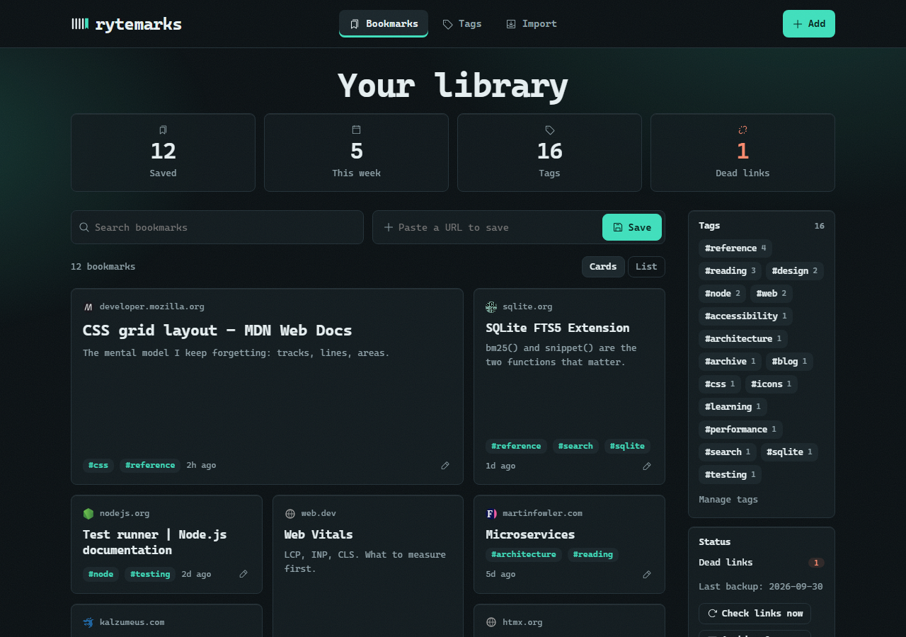
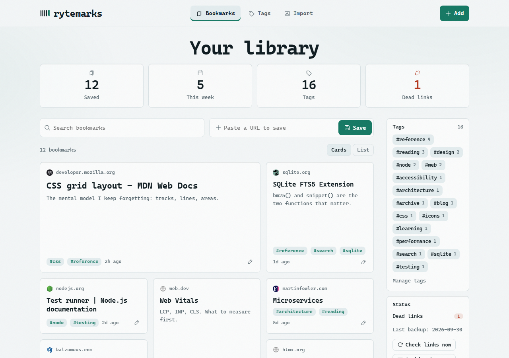
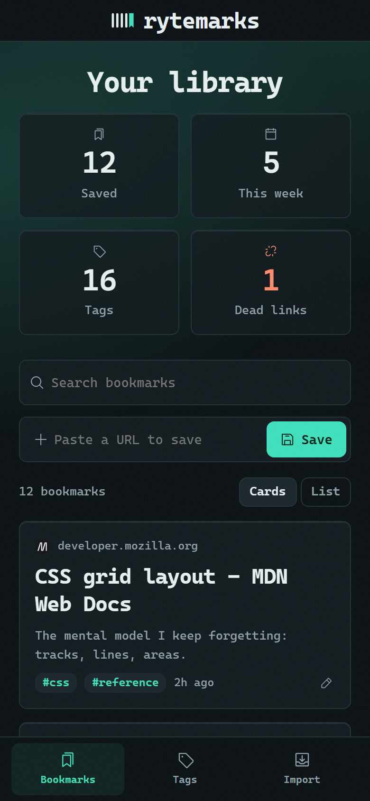

# rytemarks

[](https://github.com/trippusultan/rytemarks/actions/workflows/ci.yml)
[](LICENSE)

**A fast, private, self-hosted bookmark manager.** Save any page with one click, tag it, and search the text of everything you have saved. It runs on your own machine, keeps your whole archive in a single SQLite file, and sends nothing anywhere.



<p>
  
  
</p>

## Features

- **One-click saving** with a bookmarklet, or paste a URL into the box on the home page. Saving is instant; the page is fetched in the background.
- **Full-text search** (SQLite FTS5) across titles, your notes and the **text of the pages you saved** (a Readability extract), with highlighted snippets. Combine it with several tags at once.
- **Tags and notes**, with autocomplete, a tag manager (rename, merge, delete) and a cloud in the sidebar.
- **Cards or list**, newest first, light and dark themes that follow your system, and a layout that works on a phone.
- **Dead-link checker**: every Sunday at 03:00 (while the server runs), or on demand. Links that return 404 or 410 are flagged, and the flag clears if the page comes back.
- **Import** a browser bookmarks export (Chrome, Firefox, Edge, Safari, Raindrop) with a preview first; folders become tags. **Export** everything as JSON or CSV, and **restore** from your own JSON export.
- **Duplicate-proof**: tracking parameters (`utm_*`, `fbclid`, ...) and trailing slashes are ignored, so the same page saved twice is one bookmark.
- **Safe by default**: automatic daily backups with rotation, undo for deletes, and a secret key on the save button.
- **Private**: no accounts, no telemetry, no third-party requests, local fonts, icons inline.

## Quick start

You need **Node.js 22 or newer**.

```
git clone https://github.com/trippusultan/rytemarks.git
cd rytemarks
npm install
npm start          # http://localhost:4040
```

Open <http://localhost:4040>, then [install the save button](#install-the-save-button). `better-sqlite3` ships prebuilt binaries for Windows, macOS and Linux (x64 and arm64), so no compiler is needed on those; npm still runs a short `node-gyp` step that wants Python 3 on your PATH. If `npm install` fails with a `node-gyp` error, install Python 3 (and a C++ toolchain if your platform has no prebuilt binary).

## Configuration

Set these as environment variables before `npm start`.

| Variable | Default | What it does |
| --- | --- | --- |
| `PORT` | `4040` | Port to listen on. The save button has the port built in, so reinstall it after changing this. |
| `MARKS_DB` | `marks.db` next to `server.js` | Path of the SQLite file that holds everything. |
| `MARKS_BACKUPS` | `backups/` next to `server.js` | Folder for the automatic daily backups. |

The server always binds to `127.0.0.1`; there is deliberately no setting to change that (see [Security model](#security-model)).

## Install the save button

Open <http://localhost:4040/bookmarklet>, show your bookmarks bar (Ctrl+Shift+B, or Cmd+Shift+B on a Mac), and drag the **Save to rytemarks** button onto it. Click it on any page: a tab opens on the edit screen where you add tags and a note; press Save and the tab closes itself. If a site blocks the pop-up, use the "simple" variant on the same page. The server must be running when you click.

The button carries a secret key (a 36-character token stored in `marks.db.token` next to the database), so a web page you visit cannot make your server fetch URLs behind your back. If you ever see "Save link out of date", delete the old button and drag the new one from the same page.

## Your data, backups and restore

Everything lives in **one file**, `marks.db`: bookmarks, tags, notes, saved page text and the search index. It uses SQLite's default rollback journal, so there is no `-wal` file to forget.

- **Automatic backups.** The server writes `backups/marks-YYYY-MM-DD.db` (named for the local day) at start-up if today's is missing and every day at 02:15 while it runs, keeping the newest 14. The home page shows the date of the last one. Other files in that folder are never touched.
- **Backup on demand:** `npm run backup` (safe while the server is running; it counts as today's backup).
- **Restore from a backup file:** stop the server, copy a `marks-YYYY-MM-DD.db` over `marks.db`, start it again.
- **Restore from a JSON export:** stop the server, move `marks.db` aside, start it (it creates an empty one), open **Import** and choose a file from **Export JSON**. Bookmarks, tags, notes and saved text come back; links you already have are skipped.
- **Clean up duplicates** saved before normalisation existed: `npm run dedupe` shows what would merge (a dry run); `npm run dedupe -- --apply` first backs up to `backups/marks-before-dedupe-<time>.db`, then merges each group into its oldest bookmark (notes joined, tags combined, longest page text kept).
- **Export:** `/export?format=json` (everything, including page text) or `/export?format=csv` (no page text; risky leading `= + - @` are neutralised for spreadsheets).
- **Start at login (Windows):** put a shortcut to `start-hidden.vbs` in `shell:startup` (Win+R) to run the server without a console window. On macOS and Linux use your login items, launchd or a systemd user service to run `npm start`.

## Keyboard shortcuts

| Keys | Does |
| --- | --- |
| `Ctrl`/`Cmd` + `K` | Command palette: search, jump to a tag, open Import or Tags, or paste a URL to save it |
| `/` | Focus the search box (opens the palette on pages that have none) |
| `j` / `k` | Move through bookmarks; `Enter` opens one, `e` edits it |
| `Ctrl`/`Cmd` + `Enter` | Save from inside the note box |

## Security model

rytemarks is a **single-user app for your own computer**, not a service for the internet. It binds to `127.0.0.1`, rejects requests whose `Host` is not localhost (DNS-rebinding guard) and refuses cross-site `POST`s; `/save` needs the save-button key or a request from the app's own pages. There is **no login**, so never expose the port to a network. The server fetches the links you save, and the database is not encrypted. Details, and how to report a vulnerability, are in [SECURITY.md](SECURITY.md).

## Development

```
npm test           # node --test, about 20 seconds, no network needed
```

Tests run against a throwaway database and a fake local website, on Node 22 on Ubuntu and Windows in [CI](.github/workflows/ci.yml). The code is deliberately small: `server.js` holds the routes, rendering and styles; `backups.js`, `urls.js` and `dedupe.js` hold the pure helpers; `icons.js` holds the inline icon sprite. See [CONTRIBUTING.md](CONTRIBUTING.md) for conventions and how to run a scratch instance without touching your real bookmarks.

The logo is a tally mark (four strokes and a ribbon) drawn as inline SVG; `docs/brand/brand-board.html` holds the palette and type. The originals of the supplied logo artwork are in `docs/brand/logo/`. The database file keeps the name `marks.db` from the project's earlier name.

## Credits

- Icons: [Phosphor Icons](https://phosphoricons.com) (regular weight, MIT licence). The twenty in use are copied into `icons.js` together with the licence text.
- Page text extraction: [@mozilla/readability](https://github.com/mozilla/readability) (Apache-2.0). Page metadata: [metascraper](https://metascraper.js.org). Also built on [Express](https://expressjs.com), [better-sqlite3](https://github.com/WiseLibs/better-sqlite3), [jsdom](https://github.com/jsdom/jsdom) and [node-cron](https://github.com/node-cron/node-cron); each keeps its own licence.

## Licence

[ISC](LICENSE) © 2026 trippusultan
